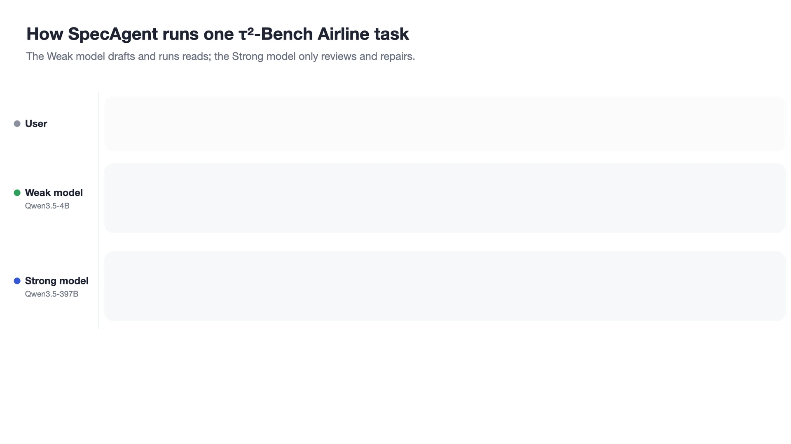

<div align="center">

# SpecAgent

**Trajectory-Level Speculation with Semantic Verification for Tool-Using Agents**

Zilin Wang, Yinhong Liu, Chao Chen, Qun Liu, Zhijiang Guo

[-b31b1b)](#citation)
[](pyproject.toml)
[](LICENSE)



</div>

A small **Weak** model drafts the agent's trajectory and a large **Strong** model reviews it.
The Strong model stops writing every step: it reads a drafted segment in one prefill pass,
keeps the longest valid prefix, and repairs only the first rejected step. Reads run while the
Weak model drafts, so every step it proposes is grounded in real observations; the first
state-changing action is held until the Strong model has reviewed it.

## How it works

| | Who | What happens |
| --- | --- | --- |
| **1. Draft** | Weak | Drafts up to K steps. Read-only tool calls execute immediately. The first state-changing action (or the final answer, where it is the graded deliverable) is held, not executed. A chunk of K reads commits without review. |
| **2. Verify** | Strong, thinking off | Reviews the chunk once and returns `{reason, accepted_steps, replacement_action}`: the longest semantically valid prefix, why the next step is wrong, and optionally a replacement call. |
| **3. Repair** | Strong, thinking on | A valid replacement executes directly. Otherwise the Strong model takes one repair turn from the committed history and the reason. The repair commits without a second review; the rejected suffix is discarded. |

## Results

Qwen3.5-4B as the Weak model and Qwen3.5-397B-A17B as the Strong model, both served on H20 GPUs.
Resources are the whole system's (both models), relative to Strong-only.

| Benchmark | Weak-only | Strong-only | SpecAgent | HBM-read | Wall time |
| --- | ---: | ---: | ---: | ---: | ---: |
| τ²-Bench Airline | 80.0 | 86.0 | **86.0** | 0.44× | 0.41× |
| τ²-Bench Retail | 80.4 | 88.6 | **87.7** | 0.55× | 0.54× |
| AutomationBench | 6.8 | 15.2 | **10.5** | 0.81× | 0.57× |
| VitaBench (Delivery) | 34.0 | 48.0 | **44.5** | 0.62× | 0.69× |

Pass@1 in %. On MCP-Atlas, with the Weak model on a local RTX 5090 and three cloud Strong models,
SpecAgent closes 53–75% of the Weak–Strong gap while the Strong model decodes 36–50% of its
Strong-only tokens. Estimated FLOPs rise (by 30–87%): the saving is memory traffic and time, not
arithmetic. Baselines (AgentCollab, Speculative Actions) and the full cost tables are in the paper.

## Quick start

```bash
pip install -e ".[tau2,automationbench]"

# SpecAgent as an OpenAI-compatible endpoint in front of your Weak and Strong models
python -m specagent.server \
  --weak-base-url http://127.0.0.1:30000/v1 --weak-model qwen3.5-4b \
  --strong-base-url https://your-provider/v1 --strong-model qwen3.5-397b-a17b \
  --strong-api-key "$STRONG_API_KEY" \
  --setting mcp_atlas          # or: vitabench
```

Point any agent that speaks OpenAI chat completions at `http://127.0.0.1:18081/v1`. Each client
session gets its own gateway state, and `--telemetry` writes one line per request with the
decision, the verdict, and every model call with its token usage. Python 3.10 or newer; model
serving is out of scope (the paper serves the Weak model with SGLang).

## Benchmarks

Every runner defaults to the paper's setting; each directory has a README with setup and run
commands.

| Benchmark | Directory | Held for review | K | Runs |
| --- | --- | --- | :---: | :---: |
| [τ²-Bench](https://github.com/sierra-research/tau2-bench) Airline, Retail | [`benchmarks/tau2`](benchmarks/tau2) | writes, transfer to a human | 6 | 3 |
| [AutomationBench](https://arxiv.org/abs/2604.18934) | [`benchmarks/automationbench`](benchmarks/automationbench) | writes, final message | 8 | 1 |
| [VitaBench](https://github.com/meituan-longcat/vitabench) Delivery | [`benchmarks/vitabench`](benchmarks/vitabench) | writes (the benchmark's own labels) | 6 | 2 |
| [MCP-Atlas](https://github.com/scaleapi/mcp-atlas) | [`benchmarks/mcp_atlas`](benchmarks/mcp_atlas) | writes, final answer | 6 | 1 |

## Repository layout

```text
src/specagent/
  runtime/gateway.py      the protocol: draft, review, repair, commit
  server.py               OpenAI-compatible HTTP server (python -m specagent.server)
  protocol/               verifier prompt and parser, prefix-commit state, action classification,
                          FLOPs / HBM-read estimator and prefix-reuse model
benchmarks/               one runner per benchmark, with patches and task lists
tests/                    unit tests and recorded model traffic for every paper setting
assets/                   the animation above
```

## Resource estimates

`specagent.protocol.flops` and `specagent.protocol.hbm` estimate per-request FLOPs and
batch-1-equivalent HBM-read from token counts (input, output, prefix-cached) and the model
architecture, for Qwen3.5-4B, Qwen3.5-397B-A17B, DeepSeek-V4-Flash-0731, and GLM-5
(`src/specagent/protocol/architectures/`). The runners record per-call token usage so these
estimates can be computed for every method alike.

How much of each request's input is a reused prefix comes from `specagent.protocol.prefix_reuse`,
the paper's model of radix prefix caching: requests are grouped into sessions (task, trial,
model, role, replica), and drafting, verification and repair requests each reuse the running
maximum of their own backbone. Its `cached_input_tokens` output is the cached count the FLOPs
and HBM-read estimators take.

## Tests

```bash
pip install pytest && pytest
```

`tests/golden/` replays scripted sessions under every paper setting and checks that each
request sent to the models is byte-identical to the recorded traffic of the code the paper runs
used. The tau2 part runs when tau2-bench with the orchestrator patch is installed; the VitaBench
tests that read the benchmark run when `VITABENCH_DIR` points at a checkout.

## Citation

```bibtex
@article{wang2026specagent,
  title   = {Trajectory-Level Speculation with Semantic Verification for Tool-Using Agents},
  author  = {Wang, Zilin and Liu, Yinhong and Chen, Chao and Liu, Qun and Guo, Zhijiang},
  journal = {arXiv preprint},
  year    = {2026}
}
```

## License

[MIT](LICENSE)
